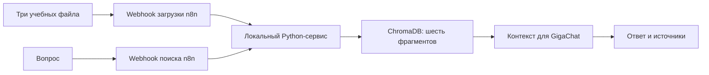

# Как работает проект



## Пример запроса
```json
{"query":"Какова гарантия и входит ли залитие?","top_k":3,"generate":true}
```

Ожидаемые факты из учебного документа: 90 календарных дней; повреждения после залития исключены. Это пример для воспроизведения, не журнал выполненного webhook-запроса.

Для проверки только поиска используется generate=false. Фактические результаты проверки хранилища: [VALIDATION.md](VALIDATION.md).
